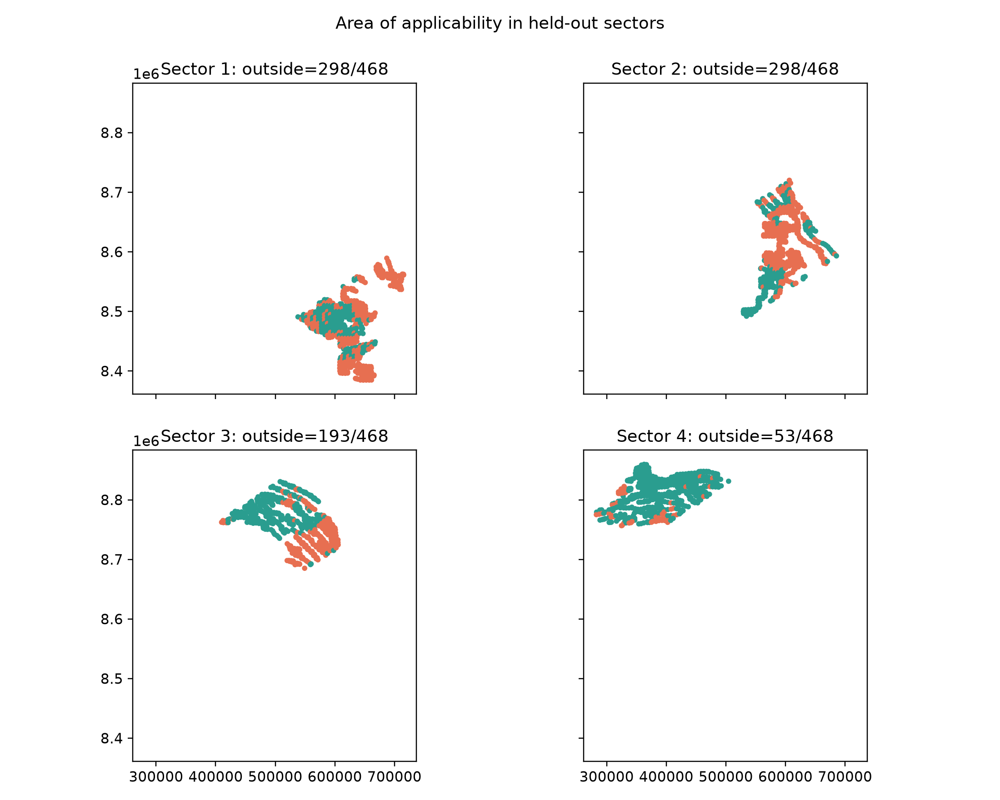
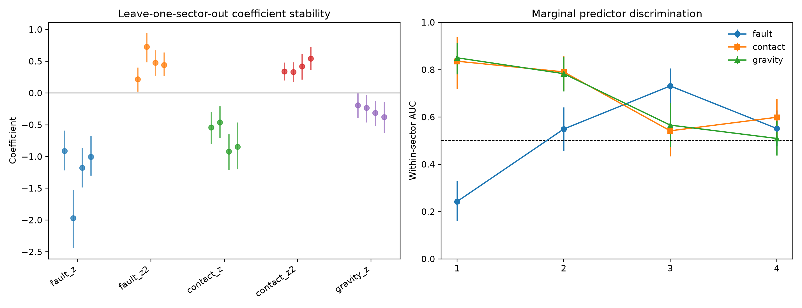
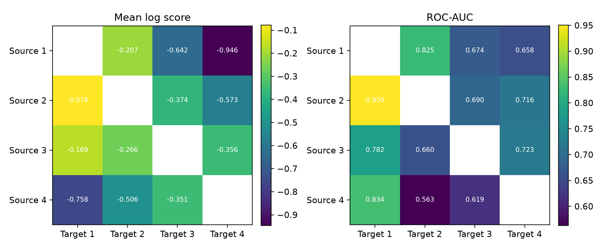
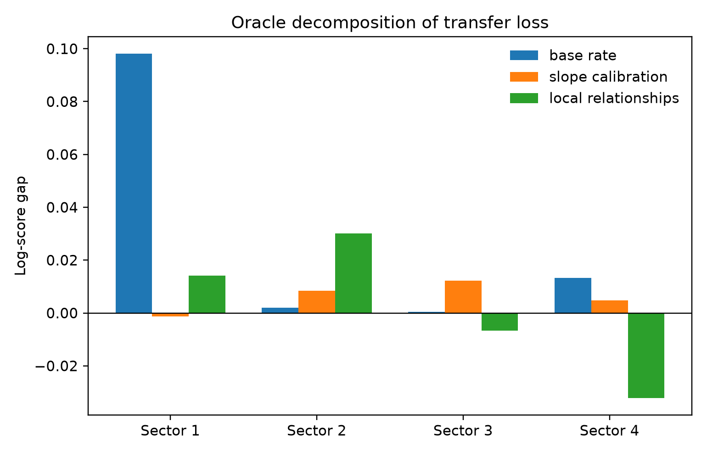

# Geographic transfer analysis report — Amendment 1

Generated: 2026-11-24T08:39:16.676081Z

Original specification SHA-256: `e9fcec158a2d9e39514dafe1341fea6f34cfafcdb4a1929fbe4aa69c8bba7e3f`

Amendment 1 specification SHA-256: `0c930f5b1a5264ebda33745eba06acf63bc7c8cc251682954ffd339c9f61608b`

The original specification remains unchanged. Version 2 records the failed MAP-MCMC gate and retires MAP, replacing all remaining fits with full MCMC. Ten random-CV repeats replace twenty as a compute-only amendment.

## Estimator decision and environment

Original MAP-Laplace mean log score was -0.267617, versus -0.263063 for MCMC; the -0.004555 per-cell difference exceeded the 0.002 tolerance. MAP and all further predictive approximations were retired.

All fits used `C:\Users\vanmu\copperbelt-mineral-prospectivity\.venv-pymc-full\Scripts\python.exe`. Recomputing the four existing MCMC predictions from their traces gave maximum absolute probability difference 9.888e-17, below the 0.01 check.

Amendment 1 fits completed: 102; convergence failures: 0. Maximum R-hat: 1.0092.

## A1. Leave-one-sector-out transfer

| sample   |    n |   positives |   mean_log_score |   log_score_skill_vs_prevalence |   relative_log_score_skill |   skill_rank |   mean_minus_observed_rate |    auc |   auc_ci_lower |   auc_ci_upper |   pr_auc |   pr_auc_baseline |   brier_skill |   calibration_in_the_large |   calibration_intercept |   calibration_slope |   v14_benchmark_auc |
|:---------|-----:|------------:|-----------------:|--------------------------------:|---------------------------:|-------------:|---------------------------:|-------:|---------------:|---------------:|---------:|------------------:|--------------:|---------------------------:|------------------------:|--------------------:|--------------------:|
| pooled   | 1872 |         138 |          -0.2631 |                          0.0092 |                     0.0338 |              |                     0.0168 | 0.7208 |         0.6868 |         0.7551 |   0.1297 |            0.0737 |       -0.0921 |                    -0.2728 |                 -1.252  |              0.4733 |                     |
| sector_1 |  468 |           9 |          -0.1825 |                         -0.0418 |                    -0.2969 |            4 |                     0.1105 | 0.8342 |         0.7473 |         0.8993 |   0.0626 |            0.0192 |       -1.0542 |                    -2.3328 |                 -2.568  |              0.7515 |              0.8753 |
| sector_2 |  468 |          31 |          -0.2428 |                          0.0018 |                     0.0074 |            3 |                     0.0096 | 0.7272 |         0.6588 |         0.7926 |   0.1253 |            0.0662 |       -0.0936 |                    -0.1754 |                 -1.2567 |              0.4631 |              0.7357 |
| sector_3 |  468 |          37 |          -0.2587 |                          0.0181 |                     0.0653 |            2 |                    -0.0035 | 0.7728 |         0.7149 |         0.8285 |   0.1861 |            0.0791 |       -0.0276 |                     0.0629 |                 -0.828  |              0.5567 |              0.6851 |
| sector_4 |  468 |          61 |          -0.3683 |                          0.0587 |                     0.1375 |            1 |                    -0.0494 | 0.7404 |         0.6843 |         0.7931 |   0.2312 |            0.1303 |        0.0647 |                     0.6118 |                 -0.1084 |              0.6647 |              0.6031 |

`calibration_in_the_large` is the pre-specified intercept with the slope fixed at 1; negative values mean predictions are too high. `calibration_intercept` and `calibration_slope` come from the joint logistic recalibration. A slope below 1 means the predictions are too spread out.

Pooled MCMC transfer log score is **-0.26306**, with prevalence-baseline skill **+0.00921** per cell. Pooled AUC is **0.7208** [0.6868, 0.7551].

## A2. Sector-to-sector transfer

| metric         |   source_sector |   target_1 |   target_2 |   target_3 |   target_4 |
|:---------------|----------------:|-----------:|-----------:|-----------:|-----------:|
| mean_log_score |               1 |            |    -0.2074 |    -0.642  |    -0.9464 |
| mean_log_score |               2 |    -0.0783 |            |    -0.3745 |    -0.5731 |
| mean_log_score |               3 |    -0.1689 |    -0.2661 |            |    -0.3561 |
| mean_log_score |               4 |    -0.7577 |    -0.5064 |    -0.3506 |            |
| auc            |               1 |            |     0.8254 |     0.6737 |     0.6582 |
| auc            |               2 |     0.9504 |            |     0.6905 |     0.7155 |
| auc            |               3 |     0.7817 |     0.6601 |            |     0.7231 |
| auc            |               4 |     0.8339 |     0.5629 |     0.6187 |            |

| source_type         |   source_sector |   source_sector_a |   source_sector_b |   target_sector |   training_cells |   training_positives |   mean_log_score |    auc |   sector_separation_km | few_training_positives   |
|:--------------------|----------------:|------------------:|------------------:|----------------:|-----------------:|---------------------:|-----------------:|-------:|-----------------------:|:-------------------------|
| single_sector       |               1 |                   |                   |               2 |              468 |                    9 |          -0.2074 | 0.8254 |                124.866 | True                     |
| single_sector       |               1 |                   |                   |               3 |              468 |                    9 |          -0.642  | 0.6737 |                289.849 | True                     |
| single_sector       |               1 |                   |                   |               4 |              468 |                    9 |          -0.9464 | 0.6582 |                404.801 | True                     |
| single_sector       |               2 |                   |                   |               1 |              468 |                   31 |          -0.0783 | 0.9504 |                124.866 | False                    |
| single_sector       |               2 |                   |                   |               3 |              468 |                   31 |          -0.3745 | 0.6905 |                164.984 | False                    |
| single_sector       |               2 |                   |                   |               4 |              468 |                   31 |          -0.5731 | 0.7155 |                279.935 | False                    |
| single_sector       |               3 |                   |                   |               1 |              468 |                   37 |          -0.1689 | 0.7817 |                289.849 | False                    |
| single_sector       |               3 |                   |                   |               2 |              468 |                   37 |          -0.2661 | 0.6601 |                164.984 | False                    |
| single_sector       |               3 |                   |                   |               4 |              468 |                   37 |          -0.3561 | 0.7231 |                114.951 | False                    |
| single_sector       |               4 |                   |                   |               1 |              468 |                   61 |          -0.7577 | 0.8339 |                404.801 | False                    |
| single_sector       |               4 |                   |                   |               2 |              468 |                   61 |          -0.5064 | 0.5629 |                279.935 | False                    |
| single_sector       |               4 |                   |                   |               3 |              468 |                   61 |          -0.3506 | 0.6187 |                114.951 | False                    |
| sector_pair         |                 |                 1 |                 2 |               3 |              936 |                   40 |          -0.4897 | 0.7172 |                        | False                    |
| sector_pair         |                 |                 1 |                 2 |               4 |              936 |                   40 |          -0.7179 | 0.6854 |                        | False                    |
| sector_pair         |                 |                 1 |                 3 |               2 |              936 |                   46 |          -0.2481 | 0.7449 |                        | False                    |
| sector_pair         |                 |                 1 |                 3 |               4 |              936 |                   46 |          -0.3536 | 0.7354 |                        | False                    |
| sector_pair         |                 |                 1 |                 4 |               2 |              936 |                   70 |          -0.2307 | 0.7684 |                        | False                    |
| sector_pair         |                 |                 1 |                 4 |               3 |              936 |                   70 |          -0.237  | 0.8025 |                        | False                    |
| sector_pair         |                 |                 2 |                 3 |               1 |              936 |                   68 |          -0.1587 | 0.8492 |                        | False                    |
| sector_pair         |                 |                 2 |                 3 |               4 |              936 |                   68 |          -0.3554 | 0.739  |                        | False                    |
| sector_pair         |                 |                 2 |                 4 |               1 |              936 |                   92 |          -0.1251 | 0.7107 |                        | False                    |
| sector_pair         |                 |                 2 |                 4 |               3 |              936 |                   92 |          -0.2989 | 0.73   |                        | False                    |
| sector_pair         |                 |                 3 |                 4 |               1 |              936 |                   98 |          -0.1162 | 0.7606 |                        | False                    |
| sector_pair         |                 |                 3 |                 4 |               2 |              936 |                   98 |          -0.2594 | 0.6795 |                        | False                    |
| other_three_sectors |                 |                   |                   |               1 |             1404 |                  129 |          -0.1825 | 0.8342 |                        | False                    |
| other_three_sectors |                 |                   |                   |               2 |             1404 |                  107 |          -0.2428 | 0.7272 |                        | False                    |
| other_three_sectors |                 |                   |                   |               3 |             1404 |                  101 |          -0.2587 | 0.7728 |                        | False                    |
| other_three_sectors |                 |                   |                   |               4 |             1404 |                   77 |          -0.3683 | 0.7404 |                        | False                    |

The single-sector and pair matrices show whether transfer changes with direction, sector separation, and the amount of training support. Entries with fewer than 15 training positives are flagged and are not interpreted alone; in particular, the apparent best source for Sector 2 is the nine-positive Sector 1 and must not be treated as a stable recommendation.

Mean absolute A-to-B versus B-to-A log-score difference is **0.1619**. The correlation between sector separation and the mean directional log score is **-0.9002**. Best single training sectors by target: Sector 1 from Sector 2, Sector 2 from Sector 1, Sector 3 from Sector 4, Sector 4 from Sector 3.

These directional scores are raw log scores. Sector separation is also correlated with prevalence, so this correlation must not be read as an isolated geographic-distance effect.

## A3. Oracle decomposition

|   sector |   n |   positives |   L_transfer |   L_base |   L_recal |   L_local |   base_minus_transfer |   base_minus_transfer_ci_lower |   base_minus_transfer_ci_upper |   recal_minus_base |   recal_minus_base_ci_lower |   recal_minus_base_ci_upper |   local_minus_recal |   local_minus_recal_ci_lower |   local_minus_recal_ci_upper |
|---------:|----:|------------:|-------------:|---------:|----------:|----------:|----------------------:|-------------------------------:|-------------------------------:|-------------------:|----------------------------:|----------------------------:|--------------------:|-----------------------------:|-----------------------------:|
|        1 | 468 |           9 |      -0.1825 |  -0.0844 |   -0.0857 |   -0.0715 |                0.0981 |                         0.0199 |                         0.1888 |            -0.0013 |                     -0.0051 |                      0.0019 |              0.0141 |                      -0.005  |                       0.0364 |
|        2 | 468 |          31 |      -0.2428 |  -0.2408 |   -0.2323 |   -0.2022 |                0.002  |                        -0.0091 |                         0.0139 |             0.0084 |                     -0.002  |                      0.0203 |              0.0302 |                       0.0002 |                       0.057  |
|        3 | 468 |          37 |      -0.2587 |  -0.2583 |   -0.2462 |   -0.2528 |                0.0004 |                        -0.0019 |                         0.0029 |             0.0122 |                     -0.0038 |                      0.0302 |             -0.0066 |                      -0.0398 |                       0.0201 |
|        4 | 468 |          61 |      -0.3683 |  -0.3551 |   -0.3503 |   -0.3825 |                0.0132 |                        -0.0096 |                         0.0362 |             0.0047 |                     -0.0044 |                      0.0131 |             -0.0321 |                      -0.0562 |                      -0.0127 |

Gap results: Sector 1: +0.0981, -0.0013, +0.0141; Sector 2: +0.0020, +0.0084, +0.0302; Sector 3: +0.0004, +0.0122, -0.0066; Sector 4: +0.0132, +0.0047, -0.0321. Positive values indicate improvement in held-out log score. Base-rate, recalibration and local steps use held-out labels and are diagnostic oracles, not deployable models. Base and recalibration re-estimate the intercept and one slope multiplier directly on the posterior-mean T0 intensity predictor; they do not reuse a MAP or posterior-median slope vector.

The local step confounds relationship differences with training size: each inner fit uses about three quarters of one sector. In Sector 1 the inner training folds hold only 3–8 positives, so its local gap falls under the same fewer-than-15-positives rule as A2 and is not interpreted alone.

## A4. Covariate shift and area of applicability

|   sector | aoa_status   |   cells |   area_km2 |   positives |   mean_log_score |
|---------:|:-------------|--------:|-----------:|------------:|-----------------:|
|        1 | outside      |     298 |   4537.04  |           8 |          -0.2335 |
|        1 | inside       |     170 |   3372.03  |           1 |          -0.093  |
|        2 | outside      |     298 |   3465.88  |          29 |          -0.3191 |
|        2 | inside       |     170 |   2015.48  |           2 |          -0.1089 |
|        3 | outside      |     193 |   1747.87  |          11 |          -0.1951 |
|        3 | inside       |     275 |   2222.95  |          26 |          -0.3034 |
|        4 | outside      |      53 |    456.287 |           9 |          -0.4429 |
|        4 | inside       |     415 |   3757.18  |          52 |          -0.3588 |

## A5. Which relationships transfer

| predictor   | coefficient_sign_stable   |   useful_auc_sectors | auc_condition   | verdict          |
|:------------|:--------------------------|---------------------:|:----------------|:-----------------|
| fault       | True                      |                    1 | False           | partly transfers |
| contact     | True                      |                    3 | True            | transfers        |
| gravity     | True                      |                    2 | False           | partly transfers |

|   sector | predictor   | orientation                                   |    auc |   auc_ci_lower |   auc_ci_upper |
|---------:|:------------|:----------------------------------------------|-------:|---------------:|---------------:|
|        1 | fault       | negative distance: closer scores higher       | 0.2428 |         0.1619 |         0.3304 |
|        1 | contact     | negative distance: closer scores higher       | 0.8359 |         0.7182 |         0.9383 |
|        1 | gravity     | negative gravity: lower gravity scores higher | 0.8503 |         0.7812 |         0.9141 |
|        2 | fault       | negative distance: closer scores higher       | 0.549  |         0.4571 |         0.6408 |
|        2 | contact     | negative distance: closer scores higher       | 0.7907 |         0.7125 |         0.8595 |
|        2 | gravity     | negative gravity: lower gravity scores higher | 0.7832 |         0.7083 |         0.8556 |
|        3 | fault       | negative distance: closer scores higher       | 0.7312 |         0.649  |         0.8062 |
|        3 | contact     | negative distance: closer scores higher       | 0.5415 |         0.4337 |         0.6427 |
|        3 | gravity     | negative gravity: lower gravity scores higher | 0.5657 |         0.4737 |         0.66   |
|        4 | fault       | negative distance: closer scores higher       | 0.5514 |         0.4768 |         0.628  |
|        4 | contact     | negative distance: closer scores higher       | 0.5989 |         0.5221 |         0.6773 |
|        4 | gravity     | negative gravity: lower gravity scores higher | 0.5093 |         0.4375 |         0.5833 |

Predictor verdicts: **fault: partly transfers; contact: transfers; gravity: partly transfers**. Sector 1 fault-distance AUC is 0.24 with close distances scored positive, so the fault relationship fails the useful-AUC condition there. This is interpreted primarily as a likely map-coverage effect: the regional fault digitization is dense in DRC and sparse in the Zambian Copperbelt, not as evidence for a geological relationship.

## A6. Optimism of non-spatial validation

| validation                                |   mean_log_score |   log_score_sd |   log_score_q2_5 |   log_score_q97_5 |    auc |   auc_sd |   auc_q2_5 |   auc_q97_5 |
|:------------------------------------------|-----------------:|---------------:|-----------------:|------------------:|-------:|---------:|-----------:|------------:|
| 10 repeats, stratified random 4-fold MCMC |          -0.2319 |         0.0009 |          -0.2331 |           -0.2305 | 0.7814 |   0.0028 |     0.7781 |      0.7857 |
| leave-one-sector-out MCMC                 |          -0.2631 |                |          -0.3103 |           -0.2171 | 0.7208 |          |     0.6868 |      0.7551 |
| V15 M0 buffered 5 km (different model)    |          -0.2957 |                |                  |                   | 0.6671 |          |            |             |
| V15 M0 buffered 10 km (different model)   |          -0.2975 |                |                  |                   | 0.6566 |          |            |             |

The 10-repeat random-CV result uses the same full MCMC estimator. The buffered rows are a separate V15 model that includes lithology.

### Pre-specified model sensitivities

| model      | sample   |    n |   positives |   mean_log_score |    auc |   brier_skill |   calibration_slope |
|:-----------|:---------|-----:|------------:|-----------------:|-------:|--------------:|--------------------:|
| T0_linear  | pooled   | 1872 |         138 |          -0.2631 | 0.675  |        0.0063 |              0.4476 |
| T0_linear  | fold_1   |  468 |           9 |          -0.1392 | 0.3638 |       -0.0224 |             -0.0777 |
| T0_linear  | fold_2   |  468 |          31 |          -0.2416 | 0.6801 |       -0.0579 |              0.4871 |
| T0_linear  | fold_3   |  468 |          37 |          -0.2904 | 0.6973 |       -0.0076 |              0.4373 |
| T0_linear  | fold_4   |  468 |          61 |          -0.381  | 0.7135 |        0.0541 |              0.7514 |
| T0_nrb     | pooled   | 1872 |         138 |          -0.2578 | 0.737  |       -0.0739 |              0.5074 |
| T0_nrb     | fold_1   |  468 |           9 |          -0.1651 | 0.8763 |       -0.8567 |              0.9036 |
| T0_nrb     | fold_2   |  468 |          31 |          -0.2394 | 0.7295 |       -0.0719 |              0.4806 |
| T0_nrb     | fold_3   |  468 |          37 |          -0.2625 | 0.7684 |       -0.0557 |              0.5353 |
| T0_nrb     | fold_4   |  468 |          61 |          -0.3642 | 0.7538 |        0.073  |              0.6955 |
| T0_rebuilt | pooled   | 1872 |         138 |          -0.2456 | 0.7431 |        0.0042 |              0.6083 |
| T0_rebuilt | fold_1   |  468 |           9 |          -0.1265 | 0.4803 |       -0.0502 |              0.09   |
| T0_rebuilt | fold_2   |  468 |          31 |          -0.2354 | 0.7529 |       -0.0848 |              0.5841 |
| T0_rebuilt | fold_3   |  468 |          37 |          -0.2549 | 0.7695 |       -0.0164 |              0.5954 |
| T0_rebuilt | fold_4   |  468 |          61 |          -0.3656 | 0.7379 |        0.0743 |              0.6737 |

Sector 1 discrimination depends strongly on specification: held-out AUC is 0.834 for T0, 0.364 for T0-linear, 0.480 for T0-rebuilt and 0.876 for T0-nrb (9 positives). Pooled AUC is less sensitive (0.675–0.743 across the sensitivities, 0.721 for T0). The Sector 1 ranking result should therefore not be quoted without this range. T0-rebuilt has a better pooled log score than T0 (-0.2456 versus -0.2631); stored faults remain primary by pre-specification, not by performance.

## A7. Domain structure does not repair transfer

| row_type                   | fault_variant   | comparison   |   mean_log_score_gain |   ci_lower |   ci_upper |   positive_folds | verdict       |
|:---------------------------|:----------------|:-------------|----------------------:|-----------:|-----------:|-----------------:|:--------------|
| fixed-effect ladder        | stored          | N1-N2        |               -0.0004 |    -0.0136 |     0.0124 |                3 | NOT SUPPORTED |
| fixed-effect ladder        | stored          | N2-N3        |                0.0136 |    -0.0027 |     0.031  |                3 | NOT SUPPORTED |
| fixed-effect ladder        | rebuilt         | N1-N2        |                0.0019 |    -0.0092 |     0.0121 |                3 | NOT SUPPORTED |
| fixed-effect ladder        | rebuilt         | N2-N3        |                0.0021 |    -0.0108 |     0.0157 |                2 | NOT SUPPORTED |
| V15 hierarchical reference | stored          | M1-M2        |                0.0062 |    -0.016  |     0.0291 |                2 | NOT SUPPORTED |
| V15 hierarchical reference | stored          | M2-M3        |                0.0304 |     0.011  |     0.053  |                3 | SUPPORTED     |

The gravity gain is approximately +0.002 with fixed effects and rebuilt faults, +0.014 with fixed effects and stored faults but with an interval including zero, and +0.030 only under the six-domain hierarchy with an interval excluding zero. Domain-varying distance terms are not supported in either fixed-effect ladder. The V15 hierarchical gravity gain was data-suggested and prior-dependent.

| source                   | comparison             |   mean_delta_log_score |   ci_lower |   ci_upper | verdict                       |
|:-------------------------|:-----------------------|-----------------------:|-----------:|-----------:|:------------------------------|
| Phase2b fixed, rebuilt   | gravity extension      |                 0.0021 |    -0.0108 |     0.0157 | not supported                 |
| Phase2c fixed, stored    | gravity extension      |                 0.0136 |    -0.0027 |     0.031  | not supported                 |
| V15 hierarchical, stored | distance heterogeneity |                 0.0062 |    -0.016  |     0.0291 | not supported                 |
| V15 hierarchical, stored | gravity extension      |                 0.0304 |     0.011  |     0.053  | supported but prior-dependent |

| source                 | model                       | sample   |    n |   positives |    auc |   mean_log_score |
|:-----------------------|:----------------------------|:---------|-----:|------------:|-------:|-----------------:|
| V15 hierarchical       | M0_global                   | pooled   | 1872 |         138 | 0.6882 |          -0.2725 |
| V15 hierarchical       | M0_global                   | fold_1   |  468 |           9 | 0.8289 |          -0.1731 |
| V15 hierarchical       | M0_global                   | fold_2   |  468 |          31 | 0.6886 |          -0.2536 |
| V15 hierarchical       | M0_global                   | fold_3   |  468 |          37 | 0.7552 |          -0.2711 |
| V15 hierarchical       | M0_global                   | fold_4   |  468 |          61 | 0.7137 |          -0.3923 |
| V15 hierarchical       | M1_domain_intercept         | pooled   | 1872 |         138 | 0.7087 |          -0.2633 |
| V15 hierarchical       | M1_domain_intercept         | fold_1   |  468 |           9 | 0.8378 |          -0.1506 |
| V15 hierarchical       | M1_domain_intercept         | fold_2   |  468 |          31 | 0.6326 |          -0.2543 |
| V15 hierarchical       | M1_domain_intercept         | fold_3   |  468 |          37 | 0.7505 |          -0.2719 |
| V15 hierarchical       | M1_domain_intercept         | fold_4   |  468 |          61 | 0.7146 |          -0.3765 |
| V15 hierarchical       | M2_domain_distance          | pooled   | 1872 |         138 | 0.734  |          -0.2571 |
| V15 hierarchical       | M2_domain_distance          | fold_1   |  468 |           9 | 0.6713 |          -0.112  |
| V15 hierarchical       | M2_domain_distance          | fold_2   |  468 |          31 | 0.6958 |          -0.2902 |
| V15 hierarchical       | M2_domain_distance          | fold_3   |  468 |          37 | 0.7751 |          -0.2493 |
| V15 hierarchical       | M2_domain_distance          | fold_4   |  468 |          61 | 0.7073 |          -0.3769 |
| V15 hierarchical       | M3_domain_distance_gravity  | pooled   | 1872 |         138 | 0.802  |          -0.2267 |
| V15 hierarchical       | M3_domain_distance_gravity  | fold_1   |  468 |           9 | 0.9695 |          -0.0799 |
| V15 hierarchical       | M3_domain_distance_gravity  | fold_2   |  468 |          31 | 0.8138 |          -0.2101 |
| V15 hierarchical       | M3_domain_distance_gravity  | fold_3   |  468 |          37 | 0.7608 |          -0.2574 |
| V15 hierarchical       | M3_domain_distance_gravity  | fold_4   |  468 |          61 | 0.729  |          -0.3595 |
| Phase2b fixed, rebuilt | N0_global                   | pooled   | 1872 |         138 | 0.7304 |          -0.2474 |
| Phase2b fixed, rebuilt | N0_global                   | fold_1   |  468 |           9 | 0.5137 |          -0.1182 |
| Phase2b fixed, rebuilt | N0_global                   | fold_2   |  468 |          31 | 0.7123 |          -0.236  |
| Phase2b fixed, rebuilt | N0_global                   | fold_3   |  468 |          37 | 0.7596 |          -0.2566 |
| Phase2b fixed, rebuilt | N0_global                   | fold_4   |  468 |          61 | 0.7265 |          -0.3788 |
| Phase2b fixed, rebuilt | N1_fixed_3b                 | pooled   | 1872 |         138 | 0.739  |          -0.2453 |
| Phase2b fixed, rebuilt | N1_fixed_3b                 | fold_1   |  468 |           9 | 0.4904 |          -0.1112 |
| Phase2b fixed, rebuilt | N1_fixed_3b                 | fold_2   |  468 |          31 | 0.6793 |          -0.2378 |
| Phase2b fixed, rebuilt | N1_fixed_3b                 | fold_3   |  468 |          37 | 0.7479 |          -0.2631 |
| Phase2b fixed, rebuilt | N1_fixed_3b                 | fold_4   |  468 |          61 | 0.7292 |          -0.3691 |
| Phase2b fixed, rebuilt | N2_3b_distance_interactions | pooled   | 1872 |         138 | 0.7448 |          -0.2434 |
| Phase2b fixed, rebuilt | N2_3b_distance_interactions | fold_1   |  468 |           9 | 0.5067 |          -0.1362 |
| Phase2b fixed, rebuilt | N2_3b_distance_interactions | fold_2   |  468 |          31 | 0.7464 |          -0.2241 |
| Phase2b fixed, rebuilt | N2_3b_distance_interactions | fold_3   |  468 |          37 | 0.7645 |          -0.2481 |
| Phase2b fixed, rebuilt | N2_3b_distance_interactions | fold_4   |  468 |          61 | 0.7046 |          -0.3652 |
| Phase2b fixed, rebuilt | N3_3b_gravity_interaction   | pooled   | 1872 |         138 | 0.7707 |          -0.2413 |
| Phase2b fixed, rebuilt | N3_3b_gravity_interaction   | fold_1   |  468 |           9 | 0.5858 |          -0.1207 |
| Phase2b fixed, rebuilt | N3_3b_gravity_interaction   | fold_2   |  468 |          31 | 0.8167 |          -0.2267 |
| Phase2b fixed, rebuilt | N3_3b_gravity_interaction   | fold_3   |  468 |          37 | 0.7431 |          -0.2632 |
| Phase2b fixed, rebuilt | N3_3b_gravity_interaction   | fold_4   |  468 |          61 | 0.7251 |          -0.3547 |
| Phase2b fixed, rebuilt | N0_global                   | pooled   | 1677 |         138 | 0.7165 |          -0.2712 |
| Phase2b fixed, rebuilt | N0_global                   | fold_1   |  310 |           9 | 0.436  |          -0.1585 |
| Phase2b fixed, rebuilt | N0_global                   | fold_2   |  447 |          31 | 0.6951 |          -0.248  |
| Phase2b fixed, rebuilt | N0_global                   | fold_3   |  468 |          37 | 0.7637 |          -0.256  |
| Phase2b fixed, rebuilt | N0_global                   | fold_4   |  452 |          61 | 0.7245 |          -0.3871 |
| Phase2b fixed, rebuilt | N1_fixed_3b                 | pooled   | 1677 |         138 | 0.7231 |          -0.269  |
| Phase2b fixed, rebuilt | N1_fixed_3b                 | fold_1   |  310 |           9 | 0.4463 |          -0.1479 |
| Phase2b fixed, rebuilt | N1_fixed_3b                 | fold_2   |  447 |          31 | 0.6426 |          -0.2546 |
| Phase2b fixed, rebuilt | N1_fixed_3b                 | fold_3   |  468 |          37 | 0.7556 |          -0.2593 |
| Phase2b fixed, rebuilt | N1_fixed_3b                 | fold_4   |  452 |          61 | 0.7256 |          -0.3764 |
| Phase2b fixed, rebuilt | N2_3b_distance_interactions | pooled   | 1677 |         138 | 0.7478 |          -0.2609 |
| Phase2b fixed, rebuilt | N2_3b_distance_interactions | fold_1   |  310 |           9 | 0.5371 |          -0.1616 |
| Phase2b fixed, rebuilt | N2_3b_distance_interactions | fold_2   |  447 |          31 | 0.7364 |          -0.231  |
| Phase2b fixed, rebuilt | N2_3b_distance_interactions | fold_3   |  468 |          37 | 0.7734 |          -0.2449 |
| Phase2b fixed, rebuilt | N2_3b_distance_interactions | fold_4   |  452 |          61 | 0.7015 |          -0.3751 |
| Phase2b fixed, rebuilt | N3_3b_gravity_interaction   | pooled   | 1677 |         138 | 0.7732 |          -0.2598 |
| Phase2b fixed, rebuilt | N3_3b_gravity_interaction   | fold_1   |  310 |           9 | 0.6478 |          -0.131  |
| Phase2b fixed, rebuilt | N3_3b_gravity_interaction   | fold_2   |  447 |          31 | 0.8078 |          -0.2446 |
| Phase2b fixed, rebuilt | N3_3b_gravity_interaction   | fold_3   |  468 |          37 | 0.7512 |          -0.2608 |
| Phase2b fixed, rebuilt | N3_3b_gravity_interaction   | fold_4   |  452 |          61 | 0.729  |          -0.3622 |
| Phase2c fixed, stored  | N0_global                   | pooled   | 1872 |         138 | 0.7032 |          -0.2596 |
| Phase2c fixed, stored  | N0_global                   | fold_1   |  468 |           9 | 0.8439 |          -0.1423 |
| Phase2c fixed, stored  | N0_global                   | fold_2   |  468 |          31 | 0.6818 |          -0.2485 |
| Phase2c fixed, stored  | N0_global                   | fold_3   |  468 |          37 | 0.7574 |          -0.2628 |
| Phase2c fixed, stored  | N0_global                   | fold_4   |  468 |          61 | 0.7272 |          -0.3848 |
| Phase2c fixed, stored  | N1_fixed_3b                 | pooled   | 1872 |         138 | 0.722  |          -0.2524 |
| Phase2c fixed, stored  | N1_fixed_3b                 | fold_1   |  468 |           9 | 0.8332 |          -0.125  |
| Phase2c fixed, stored  | N1_fixed_3b                 | fold_2   |  468 |          31 | 0.6298 |          -0.2496 |
| Phase2c fixed, stored  | N1_fixed_3b                 | fold_3   |  468 |          37 | 0.7528 |          -0.2648 |
| Phase2c fixed, stored  | N1_fixed_3b                 | fold_4   |  468 |          61 | 0.7259 |          -0.3702 |
| Phase2c fixed, stored  | N2_3b_distance_interactions | pooled   | 1872 |         138 | 0.7298 |          -0.2528 |
| Phase2c fixed, stored  | N2_3b_distance_interactions | fold_1   |  468 |           9 | 0.5173 |          -0.157  |
| Phase2c fixed, stored  | N2_3b_distance_interactions | fold_2   |  468 |          31 | 0.7266 |          -0.2365 |
| Phase2c fixed, stored  | N2_3b_distance_interactions | fold_3   |  468 |          37 | 0.7647 |          -0.2499 |
| Phase2c fixed, stored  | N2_3b_distance_interactions | fold_4   |  468 |          61 | 0.7033 |          -0.3678 |
| Phase2c fixed, stored  | N3_3b_gravity_interaction   | pooled   | 1872 |         138 | 0.7799 |          -0.2392 |
| Phase2c fixed, stored  | N3_3b_gravity_interaction   | fold_1   |  468 |           9 | 0.8134 |          -0.1309 |
| Phase2c fixed, stored  | N3_3b_gravity_interaction   | fold_2   |  468 |          31 | 0.8128 |          -0.212  |
| Phase2c fixed, stored  | N3_3b_gravity_interaction   | fold_3   |  468 |          37 | 0.7475 |          -0.2592 |
| Phase2c fixed, stored  | N3_3b_gravity_interaction   | fold_4   |  468 |          61 | 0.7251 |          -0.3547 |

## A8. Partition sensitivity

### P-GAP

|   sector |   start_km |   end_km |   length_km |   cells |   positives |   prevalence |   positives_within_10km_boundaries | domain_composition                           |
|---------:|-----------:|---------:|------------:|--------:|------------:|-------------:|-----------------------------------:|:---------------------------------------------|
|        1 |      0     |  172.209 |     172.209 |     531 |          10 |        0.019 |                                  1 | NRB_3b:358; CRZ:154; NKB:15; NRB_3a:3; SRB:1 |
|        2 |    172.209 |  300.022 |     127.813 |     386 |          30 |        0.078 |                                  2 | NRB_3b:192; NRB_3a:186; NKB:8                |
|        3 |    300.022 |  423.468 |     123.445 |     351 |          25 |        0.071 |                                  0 | NRB_3a:350; NKB:1                            |
|        4 |    423.468 |  562.088 |     138.621 |     604 |          73 |        0.121 |                                  0 | NRB_3a:588; MMSB:16                          |

### P-POS

|   sector |   start_km |   end_km |   length_km |   cells |   positives |   prevalence |   positives_within_10km_boundaries | domain_composition                            |
|---------:|-----------:|---------:|------------:|--------:|------------:|-------------:|-----------------------------------:|:----------------------------------------------|
|        1 |      0     |  248.389 |     248.389 |     787 |          35 |        0.044 |                                  2 | NRB_3b:550; CRZ:154; NRB_3a:63; NKB:19; SRB:1 |
|        2 |    248.389 |  441.33  |     192.942 |     550 |          35 |        0.064 |                                  7 | NRB_3a:545; NKB:5                             |
|        3 |    441.33  |  490.615 |      49.285 |     236 |          34 |        0.144 |                                 13 | NRB_3a:236                                    |
|        4 |    490.615 |  562.088 |      71.474 |     299 |          34 |        0.114 |                                  4 | NRB_3a:283; MMSB:16                           |

| partition   | sample   |    n |   positives |   mean_log_score |    auc |   auc_ci_lower |   auc_ci_upper |
|:------------|:---------|-----:|------------:|-----------------:|-------:|---------------:|---------------:|
| P_GAP       | pooled   | 1872 |         138 |          -0.3012 | 0.6861 |         0.6492 |         0.7203 |
| P_GAP       | sector_1 |  531 |          10 |          -0.2974 | 0.8273 |         0.7489 |         0.8956 |
| P_GAP       | sector_2 |  386 |          30 |          -0.2802 | 0.6949 |         0.6207 |         0.7628 |
| P_GAP       | sector_3 |  351 |          25 |          -0.2271 | 0.8215 |         0.7579 |         0.88   |
| P_GAP       | sector_4 |  604 |          73 |          -0.3609 | 0.7323 |         0.6817 |         0.7798 |
| P_POS       | pooled   | 1872 |         138 |          -0.3053 | 0.7111 |         0.6774 |         0.7434 |
| P_POS       | sector_1 |  787 |          35 |          -0.3406 | 0.6355 |         0.5526 |         0.7131 |
| P_POS       | sector_2 |  550 |          35 |          -0.2065 | 0.8193 |         0.7679 |         0.8663 |
| P_POS       | sector_3 |  236 |          34 |          -0.4008 | 0.7423 |         0.6641 |         0.8138 |
| P_POS       | sector_4 |  299 |          34 |          -0.3192 | 0.7467 |         0.6784 |         0.809  |

| partition   | predictor   | coefficient_sign_stable   |   useful_auc_sectors | verdict          |
|:------------|:------------|:--------------------------|---------------------:|:-----------------|
| primary     | fault       | True                      |                    1 | partly transfers |
| primary     | contact     | True                      |                    3 | transfers        |
| primary     | gravity     | True                      |                    2 | partly transfers |
| P_GAP       | fault       | True                      |                    2 | partly transfers |
| P_GAP       | contact     | True                      |                    3 | transfers        |
| P_GAP       | gravity     | True                      |                    2 | partly transfers |
| P_POS       | fault       | True                      |                    2 | partly transfers |
| P_POS       | contact     | True                      |                    1 | partly transfers |
| P_POS       | gravity     | True                      |                    1 | partly transfers |

| partition   |   random_cv_mean_log_score |   spatial_loo_mean_log_score |   optimism_gap_random_minus_spatial |
|:------------|---------------------------:|-----------------------------:|------------------------------------:|
| primary     |                    -0.2319 |                      -0.2631 |                              0.0311 |
| P_GAP       |                    -0.2319 |                      -0.3012 |                              0.0692 |
| P_POS       |                    -0.2319 |                      -0.3053 |                              0.0734 |

| partition   |   sector_log_score_correlation_with_primary | best_sector_primary   | best_sector_alternate   |
|:------------|--------------------------------------------:|:----------------------|:------------------------|
| P_GAP       |                                      0.572  | sector_1              | sector_3                |
| P_POS       |                                      0.0109 | sector_1              | sector_2                |

Partition-robust conclusion: **no**. A8 uses full MCMC for both leave-one-sector-out and single-sector fits. The verdicts that change are: contact (transfers under the primary partition, partly transfers under P-POS). Because the pre-specified rule requires the A5 verdicts to agree under all three partitions, this change alone makes the conclusions not partition-robust. The sector-profile correlations are descriptive only: sectors cover different ground under each partition, and raw log scores mainly track sector prevalence. The decomposition remains a primary-partition diagnostic.

## Figures

## Plain-language summary

- **Ranking transfers moderately.** A model trained on three sectors ranks cells in the fourth with pooled AUC 0.721 [0.687, 0.755] and sector AUCs of 0.727–0.834. Sector 1's value is fragile across specifications (see 'Pre-specified model sensitivities').
- **Probabilities do not transfer.** Pooled calibration slope is 0.47. Calibration-in-the-large is -2.33, -0.18, +0.06, +0.61 in Sectors 1–4 (negative: predicted too high). In Sector 1 the mean predicted probability exceeds the observed rate by 0.111, and the model scores worse than the training-prevalence baseline (skill -0.042 per cell). Skill is +0.002, +0.018 and +0.059 in Sectors 2–4.
- **Why (oracle decomposition).** In Sector 1 an intercept-only correction recovers +0.098 per cell [+0.020, +0.189], so the loss there is mainly a base-rate shift. In Sectors 2–4 base-rate and slope corrections are small. A local model beats the recalibrated transfer model only in the mixed Sector 2 (+0.030 [+0.000, +0.057]). In Sector 4 it is worse (-0.032 [-0.056, -0.013]), so other sectors' data help there more than local data do. These are oracle diagnostics, not deployable corrections.
- **Predictors.** fault: partly transfers; contact: transfers; gravity: partly transfers. Gravity is useful within the south-eastern sectors only. The Sector 1 fault reversal is treated as a likely map-coverage effect.
- **Random cross-validation is optimistic.** Random 4-fold CV gives log score -0.2319 and AUC 0.781, against -0.2631 and 0.721 for leave-one-sector-out. That is an optimism of 0.031 per cell, rising to 0.069–0.073 under the alternative partitions.
- **Domain structure does not repair transfer** (A7).
- **Not partition-robust under the pre-specified rule.** The verdicts that change are: contact (transfers under the primary partition, partly transfers under P-POS).

## Limitations

- Four sectors provide four spatial units, not a precise sampling distribution.
- Sector 1 has only nine positives.
- Canonical equal-cell fold boundaries are arbitrary relative to deposit clusters.
- Prevalence ranges from 1.9% to 13.0%.
- Residual autocorrelation crosses sector boundaries.
- Geology and geography are strongly confounded.
- Fault-distance coverage differs between DRC and Zambia.
- Transfer along one belt is not frontier transfer.
